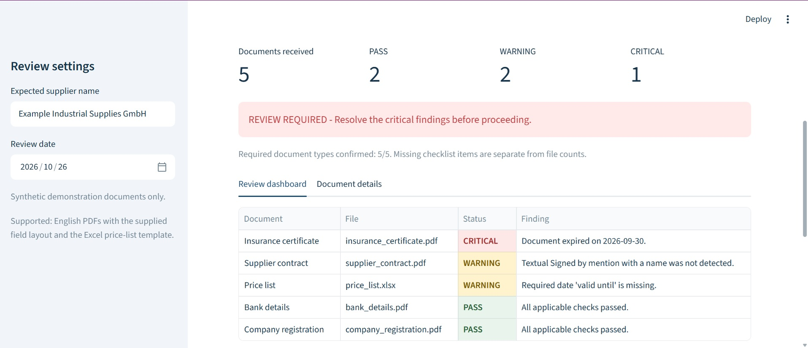
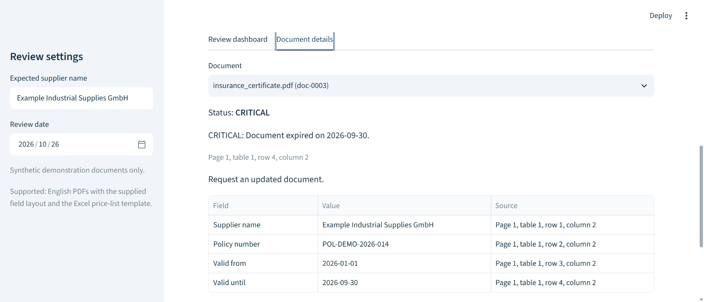
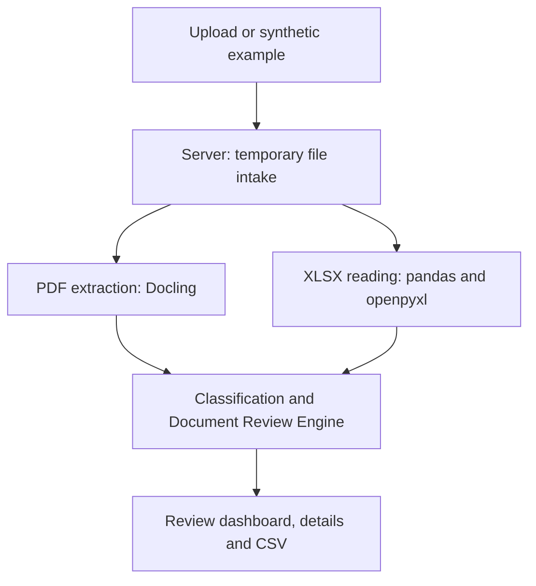

# Administrative Document Review Assistant

An evolving B2B document-review project that turns administrative files into
prioritized findings for human review.

The first implemented workflow is supplier onboarding. The working local V1
supports defined PDF and Excel layouts; further document structures and business
conditions will be added incrementally as they are tested.

## Business problem

Before creating a supplier in a purchasing system, an administrator checks a
contract, insurance certificate, company registration, bank-details document and
price list. Missing documents, incomplete fields and expired certificates can be
easy to overlook across several PDF and Excel files.

## What the application delivers

- A required-document checklist and PASS / WARNING / CRITICAL statuses.
- Prioritized findings with evidence, source locations and suggested actions.
- A detail view for inspecting extracted fields and review outcomes.
- A downloadable CSV for follow-up.

The custom Document Review Engine combines content classification, twelve
deterministic checks, exceptions and severity aggregation. Mature open-source
libraries provide extraction and spreadsheet reading.

## Screenshots

### Review dashboard

Five received documents: two PASS, two WARNING and one CRITICAL, with findings
prioritized for human review.

### Traceable finding

The insurance detail shows the extracted expiry date, its location in the PDF
and the action to request an updated document.

## General architecture

One Python application performs extraction and review on the server.
Streamlit provides the interface. Docling handles PDFs; pandas and openpyxl read
the Excel template. Results remain in the active session.

**Stack:** Python 3.12, Docling, pandas, openpyxl, Streamlit and pytest.

## Verified demonstration

All documents, suppliers and bank details are synthetic. With the fixed
2026-10-26 review date:

| Dossier | PASS | WARNING | CRITICAL | Overall |
| --- | ---: | ---: | ---: | --- |
| Complete dossier | 5 | 0 | 0 | CLEAR |
| Dossier requiring review | 2 | 2 | 1 | REVIEW REQUIRED |

The second dossier contains an expired insurance certificate, a missing textual
signature indicator and a missing price-list validity date. Additional manual
checks confirmed missing-document detection, an empty PDF and an exact duplicate.
The Windows test suite passed **80 tests and 25 subtests**.

## Incremental development

This project will grow through small, validated additions. The following directions
are planned; they are not capabilities of the current V1.

| Direction | Intended improvement |
| --- | --- |
| More document layouts | Recognize additional titles, field labels, date formats and field arrangements, one document family at a time. |
| More review conditions | Extend completeness and consistency checks according to each administrative use case. |
| Additional input formats | Evaluate DOCX and OCR for selected scanned documents when supported by representative test cases. |
| Broader validation | Recreate varied document structures with entirely fictional data and record the expected review results. |
| Hosted demonstration | Consider public hosting after validating the supported cases, error handling and resource requirements. |

Each addition should state what is supported, include normal and anomalous examples,
and preserve the evidence and source locations needed for human review.

## Current scope and status

The V1 is a validated local demonstrator for one supplier at a time, English
digital PDFs with the supplied field layout and a fixed Excel template.
Signature checks detect a textual indicator; bank checks inspect the demo IBAN
format. These checks do not authenticate signatures or verify bank accounts.

Human review remains necessary. OCR, public hosting, accounts, persistent review
history and ERP integration are outside this delivered V1.

The implementation repository remains private. This repository is a portfolio
showcase containing the project overview, screenshots, general architecture and
development directions. Application source and detailed review policies are kept
in the private implementation repository.

The local V1 is complete for its documented scope. A demonstration video and public
hosting are not part of this showcase release. No public live-demo URL is available.
